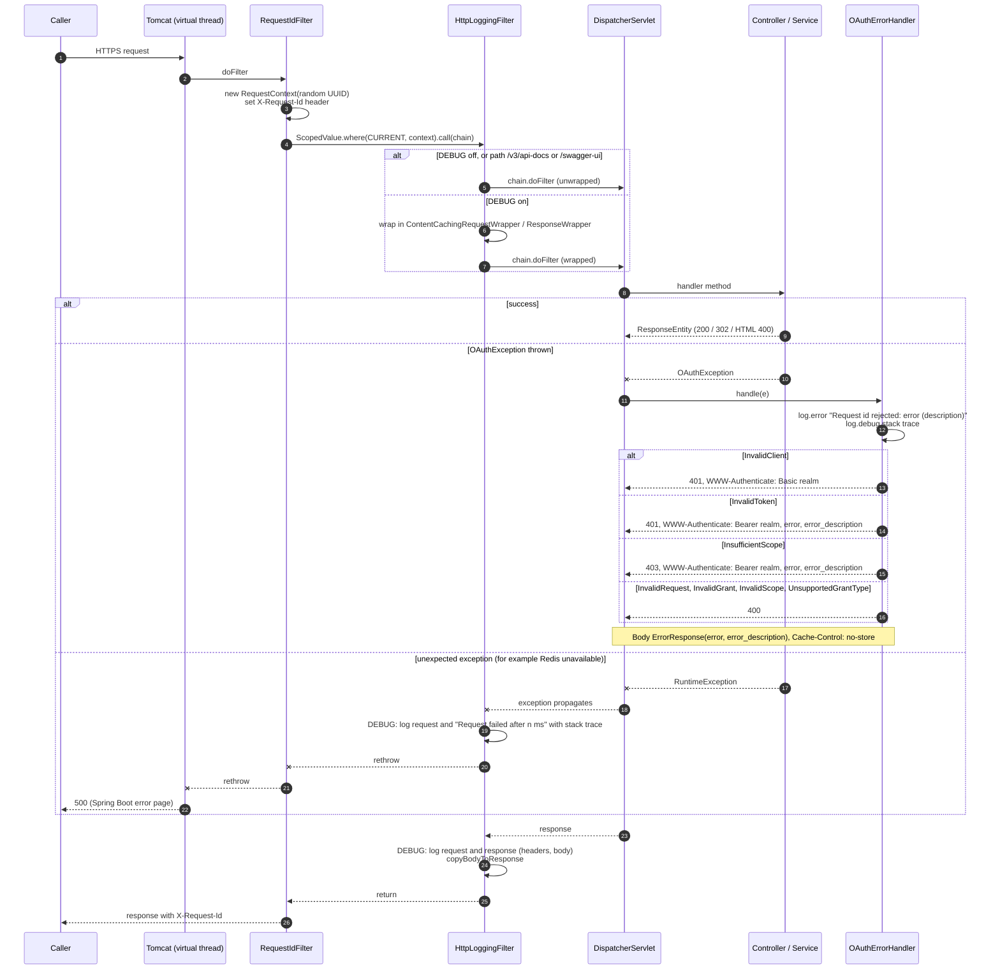

# Request pipeline and error handling

Every request passes through the same filters. Services signal OAuth errors by throwing a subclass of the sealed `OAuthException`; `OAuthErrorHandler` turns it into the RFC 6749 JSON error. The other flows refer to this diagram for the error responses.

