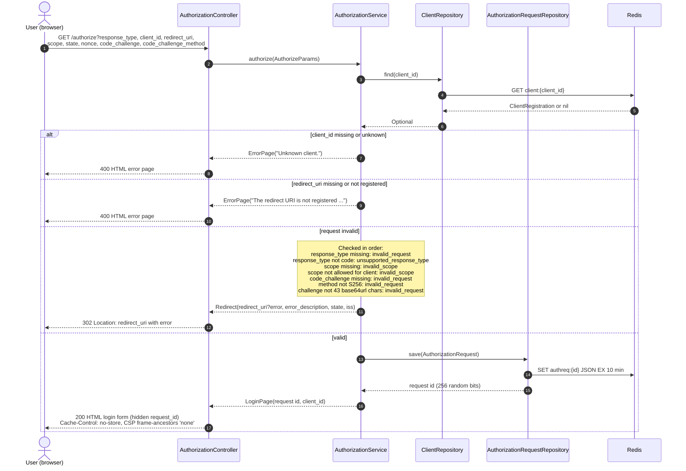

# Authorization request (GET /authorize)

The browser arrives from the client application. An unknown client or unregistered `redirect_uri` is shown as an HTML error page, because redirecting there would be unsafe. Every other error is redirected back to the client with `error`, `error_description`, `state` and `iss`.

