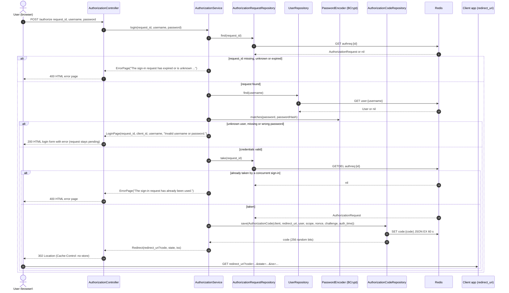

# Sign-in and authorization code (POST /authorize)

The login form posts the pending request id with the credentials. On success the request is consumed with `GETDEL`, so a concurrent second sign-in for the same request fails.

