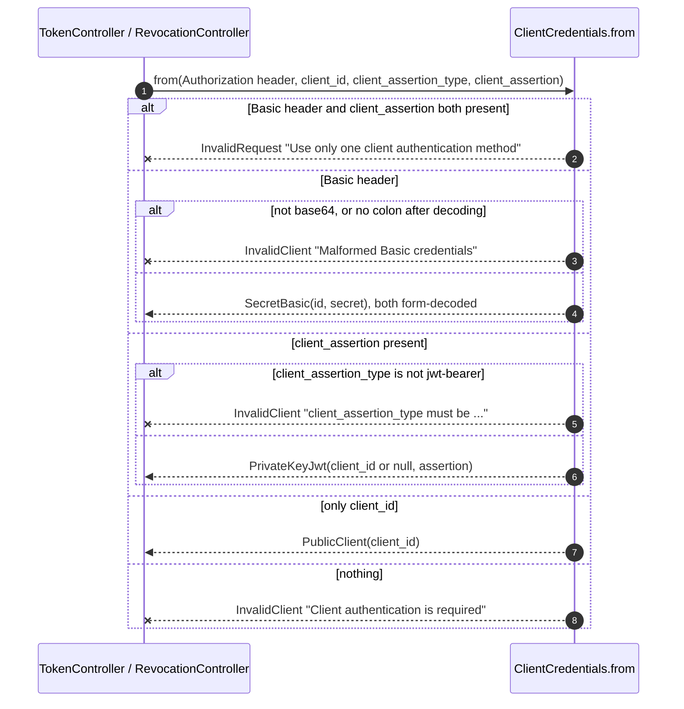
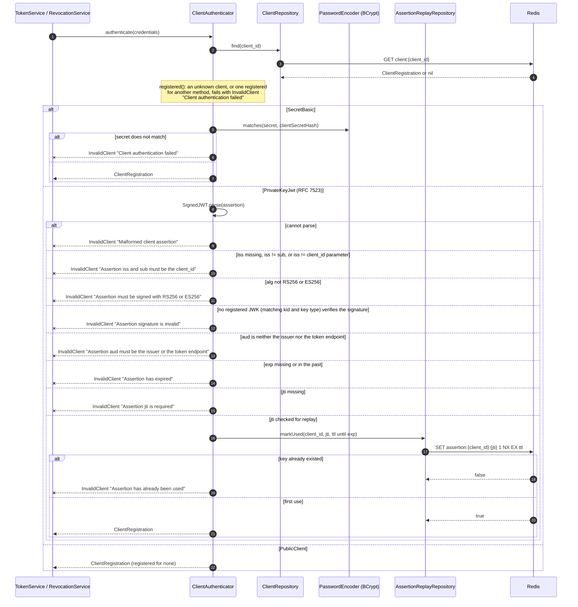

# Client authentication (token and revocation endpoints)

The controller picks the method from the request (`ClientCredentials.from`), then `ClientAuthenticator` checks it against the client's registered method. Every failure is an `InvalidClient` (401, `WWW-Authenticate: Basic`) except using two methods at once, which is an `InvalidRequest` (400). See [the request pipeline](00-request-pipeline.md) for how errors become responses.

## Choosing the method

## Verifying the credentials

