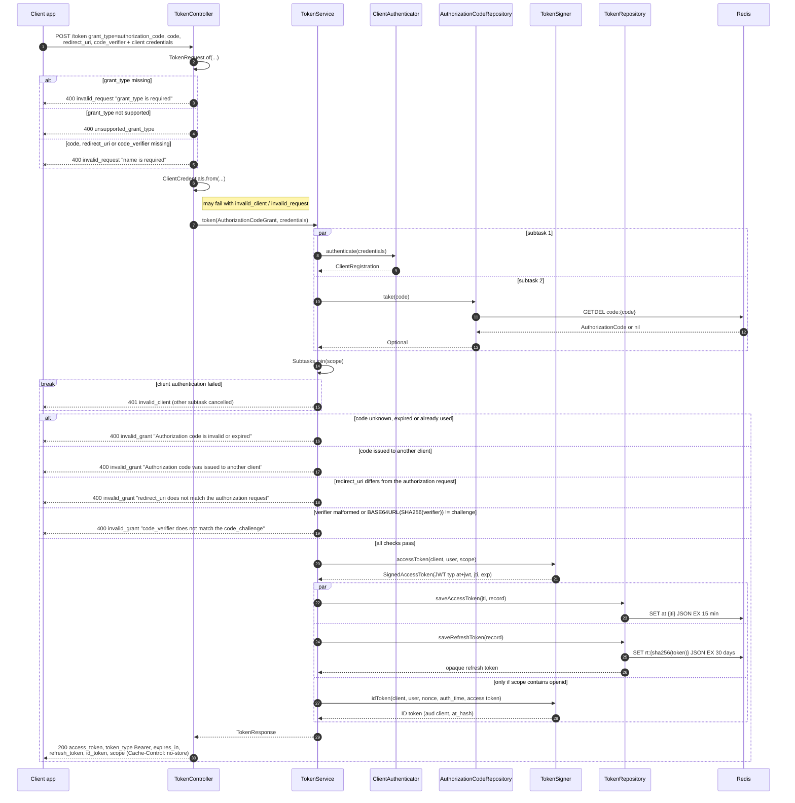

# Token request: authorization code grant (POST /token)

Client authentication and redeeming the code run in parallel as subtasks of a `StructuredTaskScope`, each on its own virtual thread. If one subtask fails, the other is cancelled and its exception is rethrown by `Subtasks.join`. The code is consumed with `GETDEL` before any check, so a failed attempt cannot be retried. Client authentication is detailed in [03-client-authentication.md](03-client-authentication.md).

