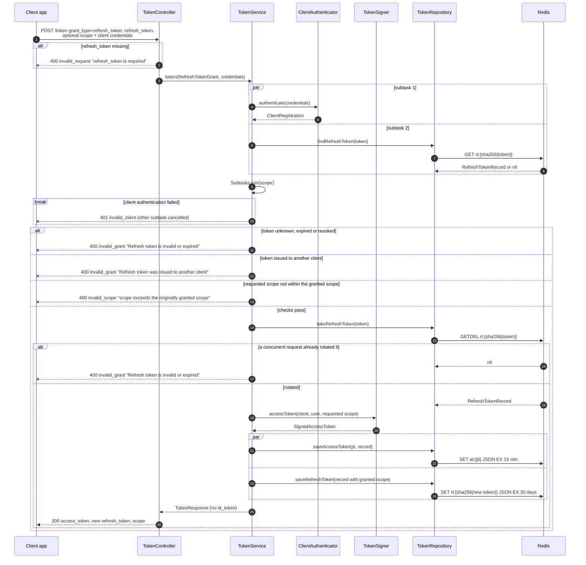

# Token request: refresh token grant (POST /token)

The refresh token is rotated: the old one is deleted with `GETDEL` and a new one with the originally granted scope is issued. Of two concurrent requests with the same token, only one wins. Validation of `grant_type` and client credentials in the controller is the same as in [04-token-authorization-code.md](04-token-authorization-code.md).

