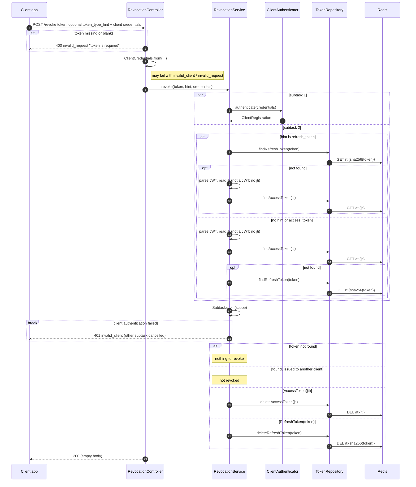

# Token revocation (POST /revoke, RFC 7009)

Client authentication and the token lookup run in parallel subtasks. The hint only decides which lookup runs first. The endpoint answers 200 also when the token is unknown, expired or belongs to another client, so it reveals nothing about other clients' tokens.

