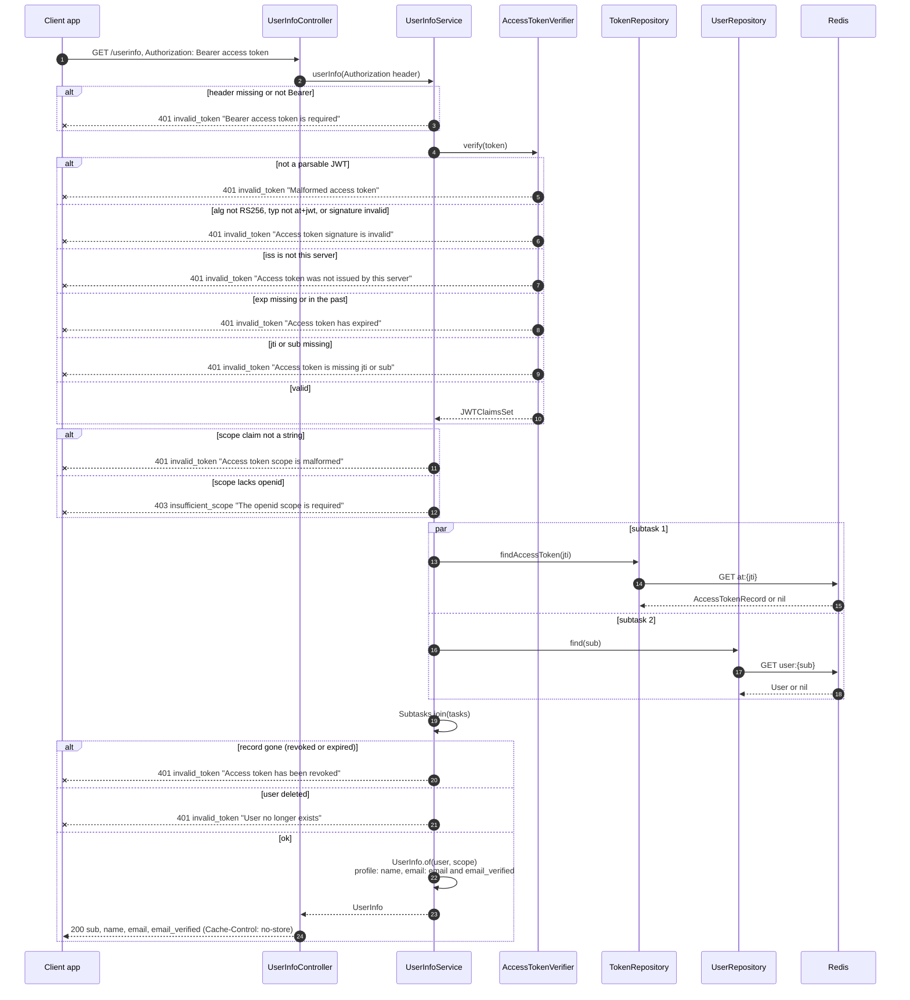

# UserInfo (GET or POST /userinfo)

The access token is verified locally (signature, type, issuer, expiry). Then the revocation check (`at:{jti}` still in Redis) and the user lookup run in parallel subtasks. Token errors answer 401 with `WWW-Authenticate: Bearer`, a missing `openid` scope 403.

