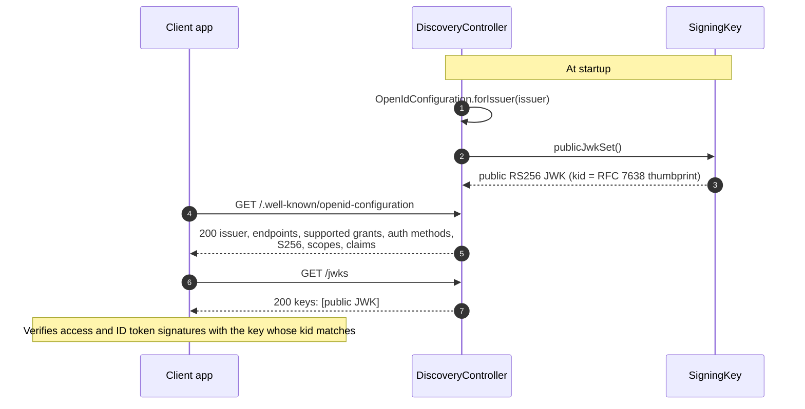

# Discovery and JWKS

Both documents are built once when the controller is created and served as is. They have no error paths of their own; unexpected failures are handled as in [the request pipeline](00-request-pipeline.md).

